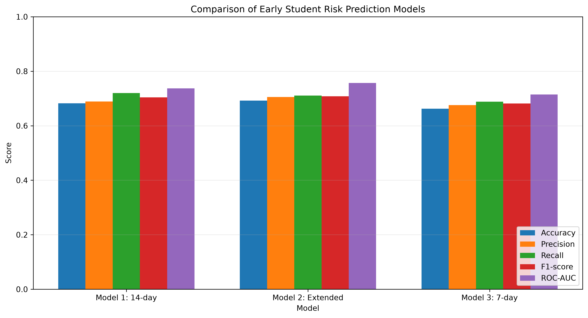
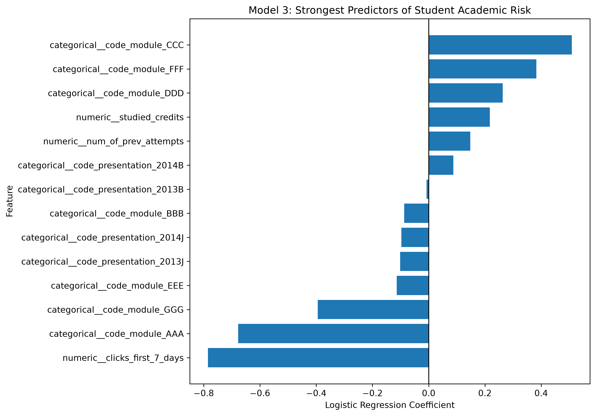
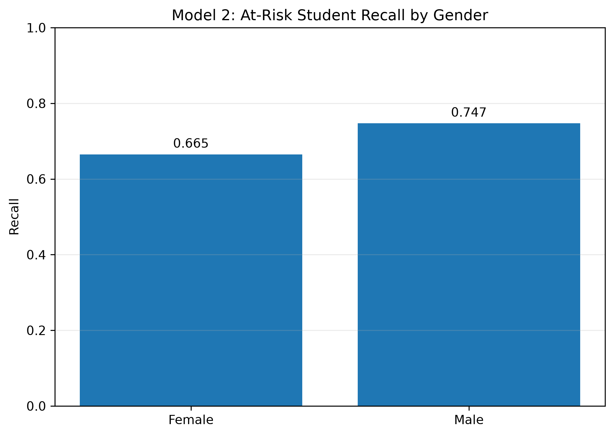

# Early Prediction of Student Academic Outcomes Using Learning Analytics

A machine learning research project investigating whether early student engagement and demographic information can help identify students at risk of failing or withdrawing from an online course.

## Research Question

**Can students at risk of failing or withdrawing be identified using early learning activity and student information?**

The goal is to investigate whether information available early in a course can help identify students who may benefit from timely academic support.

## Project Overview

This project uses the [Open University Learning Analytics Dataset (OULAD)](https://analyse.kmi.open.ac.uk/open_dataset) to investigate the early prediction of student academic outcomes.

I developed and compared three logistic regression models using different engagement windows and feature sets. The project includes data exploration, feature engineering, model evaluation, and an exploratory fairness analysis.

The target variable groups final academic outcomes into two categories:

- **At risk (1):** Fail or Withdrawn
- **Not at risk (0):** Pass or Distinction

The modeling dataset contains **32,593 student-course records**. Approximately 52.8% of the records belong to the at-risk category.

The intended application is to explore how predictive analytics might support early student outreach. The models are experimental and are not intended to replace academic judgment or determine student opportunities.

## Key Findings

- **Best ROC-AUC:** Model 2 achieved approximately 0.757.
- **Highest recall:** Model 1 achieved approximately 0.720 at its evaluated classification threshold.
- **Earlier prediction:** Model 3 used engagement information from only the first seven days and achieved a ROC-AUC of approximately 0.715.
- **Fairness consideration:** Model 2's recall differed by approximately 8.2 percentage points between female and male records in the test set.

These findings suggest that early learning activity may provide useful predictive information. However, the results are specific to this dataset and evaluation procedure and require further validation before practical use.

## Dataset

**Source:** [Open University Learning Analytics Dataset (OULAD)](https://analyse.kmi.open.ac.uk/open_dataset)

OULAD contains information about students, courses, assessments, and interactions with online learning materials.

This project uses student-course records and early engagement information to construct predictive features.

The original final outcome is used to define the target label but is excluded from the model's input features to prevent target leakage. Information from future learning activity is also excluded from the early engagement features.

The original and processed datasets are not stored in this repository. Users must obtain the dataset from the official source and follow its applicable terms of use.

## Methods

The project follows these steps:

1. Explore the dataset and examine the distribution of student outcomes.
2. Construct early engagement features from online learning activity.
3. Define a binary target for failing or withdrawing.
4. Split the data into training and test sets while checking for student overlap.
5. Build logistic regression pipelines with appropriate preprocessing.
6. Evaluate model performance using multiple classification metrics.
7. Examine performance differences across gender and age groups.
8. Discuss limitations, generalizability, and responsible use.

### Models Compared

| Model | Main features |
|---|---|
| Model 1: 14-day engagement | Click activity during the first 14 days, previous attempts, studied credits, course module, and course presentation |
| Model 2: Extended features | Model 1 features plus gender, region, highest education, IMD band, age band, and disability |
| Model 3: 7-day engagement | Click activity during the first 7 days, previous attempts, studied credits, course module, and course presentation |

The models use logistic regression with preprocessing pipelines. Numeric and categorical variables are handled using appropriate imputation, scaling, and one-hot encoding steps.

Student-level train/test overlap was checked to reduce the risk of records from the same student appearing in both sets. This check helps prevent information leakage between training and testing, although it does not establish generalization to entirely new courses or institutions.

## Results

### Model Performance Comparison

| Metric | Model 1: 14-day | Model 2: Extended | Model 3: 7-day |
|---|---:|---:|---:|
| Accuracy | 0.682 | 0.692 | 0.663 |
| Precision | 0.689 | 0.706 | 0.676 |
| Recall | 0.720 | 0.711 | 0.688 |
| F1-score | 0.704 | 0.708 | 0.682 |
| ROC-AUC | 0.737 | 0.757 | 0.715 |

*The metrics above are rounded from the reported model evaluation results.*



Model 2 achieved the highest accuracy, precision, F1-score, and ROC-AUC among the three models. Its ROC-AUC of approximately 0.757 indicates better discrimination between the two outcome categories than the other models in this evaluation.

Model 1 achieved the highest recall, at approximately 0.720. At its evaluated classification threshold, it identified a larger proportion of at-risk records than the other models.

Model 3 used only the first seven days of engagement data and achieved lower performance than Model 1, which used a 14-day engagement window. This suggests that the additional engagement period may provide useful predictive information in this dataset.

Accuracy, precision, recall, and F1-score depend on the selected classification threshold. ROC-AUC evaluates discrimination across thresholds, but it does not establish that predicted probabilities are well calibrated.

These results demonstrate predictive associations, not causal relationships. They do not establish that any feature causes students to fail or withdraw.

## Feature Analysis

Logistic regression coefficients can help explain how model features are associated with its predictions. The coefficient plot for Model 3 shows selected features with the largest absolute coefficients.



Positive coefficients increase the model's predicted log-odds of the at-risk class, while negative coefficients decrease them, assuming the target encoding and coefficient extraction are consistent with the reported model.

Categorical variables are represented through one-hot encoding. Their coefficients should be interpreted relative to the relevant reference category and in the context of the preprocessing pipeline.

Coefficient magnitude alone does not establish causal importance. Standardization, category frequencies, correlated features, and the chosen reference categories can affect interpretation.

## Fairness Analysis

Model 2 was examined across gender and age groups to explore differences in its ability to identify at-risk records.

### Gender

| Group | Test records | Recall | Precision |
|---|---:|---:|---:|
| Female | 2,887 | 0.665 | 0.694 |
| Male | 3,584 | 0.747 | 0.714 |



The recall difference between male and female records was approximately 8.2 percentage points. This means that, at the evaluated threshold, the model identified different proportions of at-risk records in the two groups.

In an educational setting, differences in recall could matter because students missed by the model might not receive timely support.

### Age

| Age group | Test records | Recall | Precision |
|---|---:|---:|---:|
| 0–35 | 4,530 | 0.741 | 0.706 |
| 35–55 | 1,899 | 0.633 | 0.705 |
| 55 and older | 42 | 0.500 | 0.643 |

Recall differed across the reported age groups. The oldest group contained only 42 test records, so its estimates are particularly uncertain.

These observed differences do not by themselves establish that the model is discriminatory. A more complete fairness evaluation would examine additional metrics, uncertainty estimates, subgroup sizes, and performance on independent datasets.

## Limitations

Several limitations should be considered when interpreting the results.

- **Generalizability:** The dataset comes from a particular online learning environment. Results may differ at other institutions, in other courses, or among different student populations.
- **Target definition:** Failing and withdrawing are combined into one category, even though they may have different causes and require different support.
- **Engagement measurement:** Click counts measure recorded interactions, not necessarily learning, motivation, or understanding.
- **Prediction errors:** The models do not identify every at-risk record and may incorrectly flag students who would otherwise succeed.
- **Fairness uncertainty:** Group-level metrics may be affected by sample sizes, feature distributions, and other differences in the data.
- **Interpretability:** Predictive associations do not explain why a student experiences academic difficulty.
- **External validation:** The reported evaluation does not establish performance on independent institutions or future course presentations.
- **Practical deployment:** Real-world use would require privacy protections, validation, ongoing performance and fairness monitoring, and meaningful human oversight.

The models should be considered research tools for investigating early academic risk, not systems for making consequential decisions about students.

## Future Work

Potential extensions include:

1. Evaluate performance on a separate course presentation or another independent dataset.
2. Compare logistic regression with other suitable machine learning methods.
3. Investigate classification thresholds that balance identifying at-risk students with the burden of false alarms.
4. Evaluate probability calibration and uncertainty.
5. Expand the fairness analysis using additional metrics and uncertainty estimates.
6. Investigate whether supportive interventions based on early warning signals improve student outcomes.

These extensions would help determine how robust, useful, and responsible early prediction systems could be.

## Repository Structure

```text
educational-data-mining/
├── notebooks/
│   ├── 01_data_understanding.ipynb
│   ├── 02_early_engagement.ipynb
│   └── 03_risk_prediction.ipynb
├── report/
│   ├── research_question.md
│   ├── research_report.md
│   └── results/
│       └── figures/
├── data/                  # Local datasets, excluded from Git
├── README.md
├── requirements.txt
└── .gitignore
```

This is a simplified overview. Other folders may exist in the repository.

## Tools and Technologies

- **Python** for data analysis and modeling
- **Pandas and NumPy** for data processing
- **Scikit-learn** for preprocessing, logistic regression, and evaluation
- **Matplotlib and Seaborn** for visualization
- **Jupyter Notebook and VS Code** for analysis
- **Git and GitHub** for version control and project documentation

## Reproducing the Analysis

### 1. Clone the repository

```powershell
git clone https://github.com/AungBhonePyae00/educational-data-mining.git
cd educational-data-mining
```

### 2. Create and activate a virtual environment

On Windows PowerShell:

```powershell
python -m venv .venv
.\.venv\Scripts\Activate.ps1
```

### 3. Install dependencies

```powershell
python -m pip install -r requirements.txt
```

### 4. Obtain the dataset

Download OULAD from the [official dataset website](https://analyse.kmi.open.ac.uk/open_dataset).

Place the required raw CSV files in the local `data/raw/` directory, following the paths used in the notebooks. The data files are excluded from version control.

### 5. Run the notebooks

Open the repository in VS Code or Jupyter and run the notebooks in the documented order:

1. `notebooks/01_data_understanding.ipynb`
2. `notebooks/02_early_engagement.ipynb`
3. `notebooks/03_risk_prediction.ipynb`

Follow any data preparation instructions documented in the notebooks. Exact package versions and dataset paths may need to match the current project configuration.

## References

Kuzilek, J., Hlosta, M., & Zdrahal, Z. (2017). Open University Learning Analytics dataset. *Scientific Data, 4*, 170171. https://doi.org/10.1038/sdata.2017.171

Open University Learning Analytics Dataset. https://analyse.kmi.open.ac.uk/open_dataset

Scikit-learn documentation. https://scikit-learn.org/stable/

## Conclusion

This project investigates whether early learning activity and student information can help identify students at risk of failing or withdrawing. The three logistic regression models demonstrate how the selected features and engagement window affect predictive performance.

The extended model achieved the highest ROC-AUC in this evaluation, while the 14-day baseline achieved the highest recall. The fairness analysis also highlighted differences in recall across demographic groups, showing why overall performance alone is not sufficient for evaluating educational prediction systems.

Further validation is needed before drawing conclusions about generalizability or practical effectiveness. The long-term goal is to explore whether learning analytics can help educators offer timely, supportive interventions while protecting student privacy and maintaining human oversight.

## Full Research Report

For a more detailed discussion of the research question, methodology, results, fairness analysis, and limitations, see [`report/research_report.md`](report/research_report.md).
